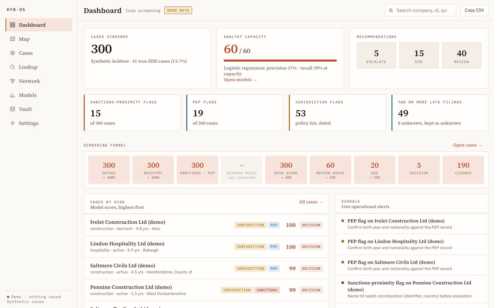
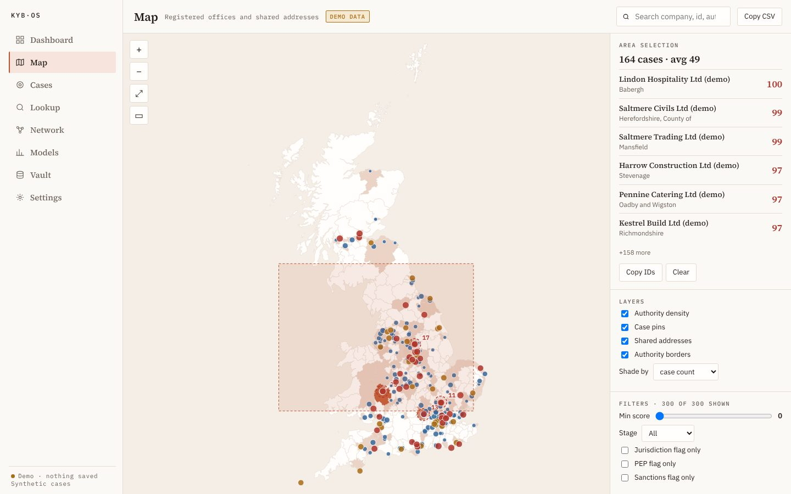
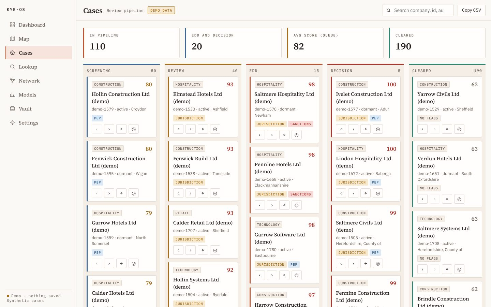
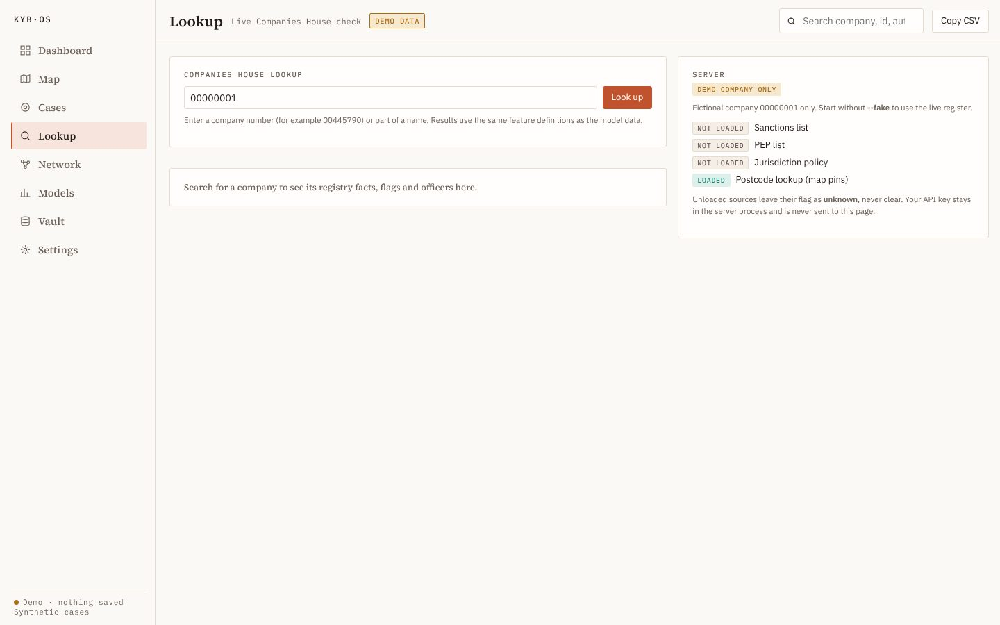
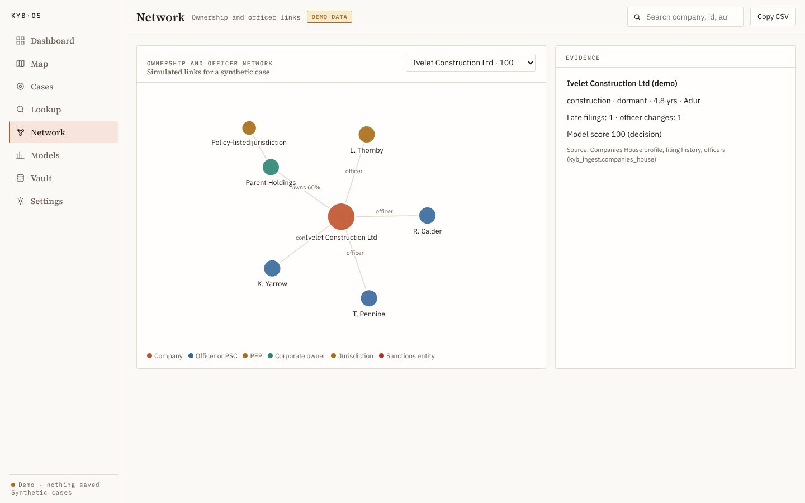
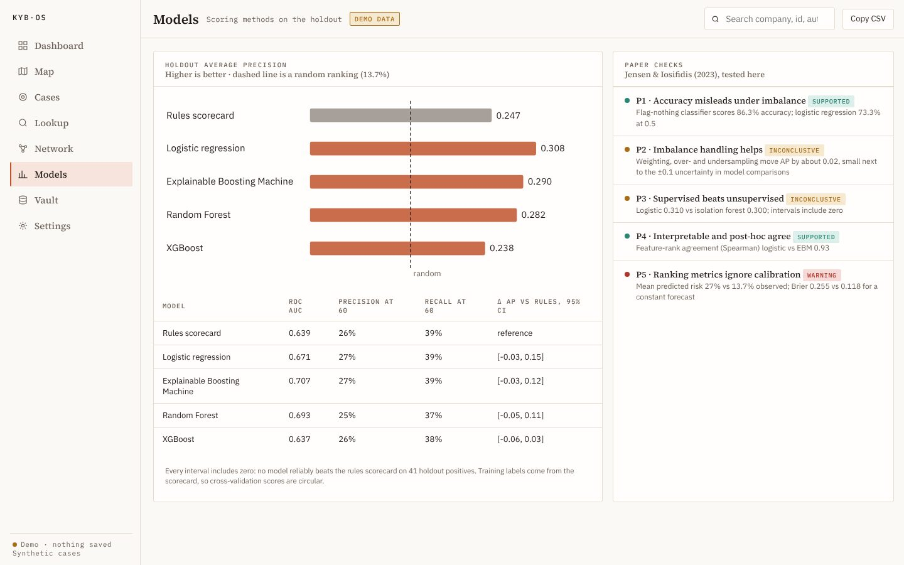
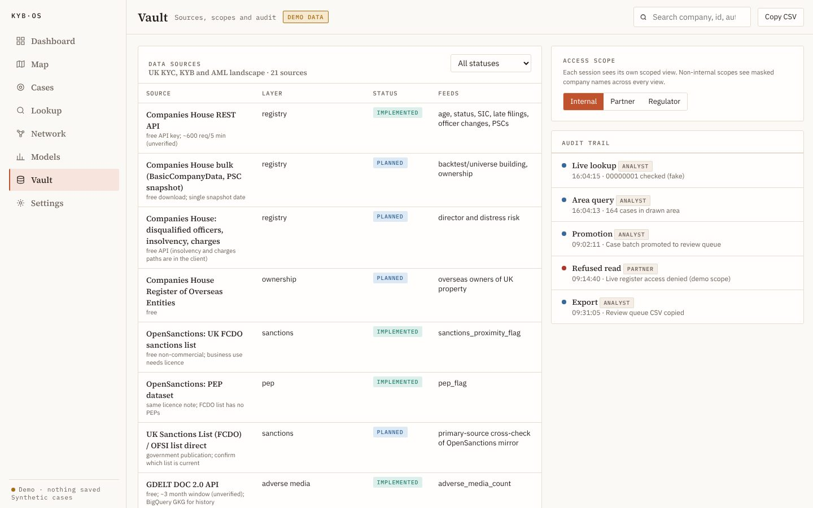
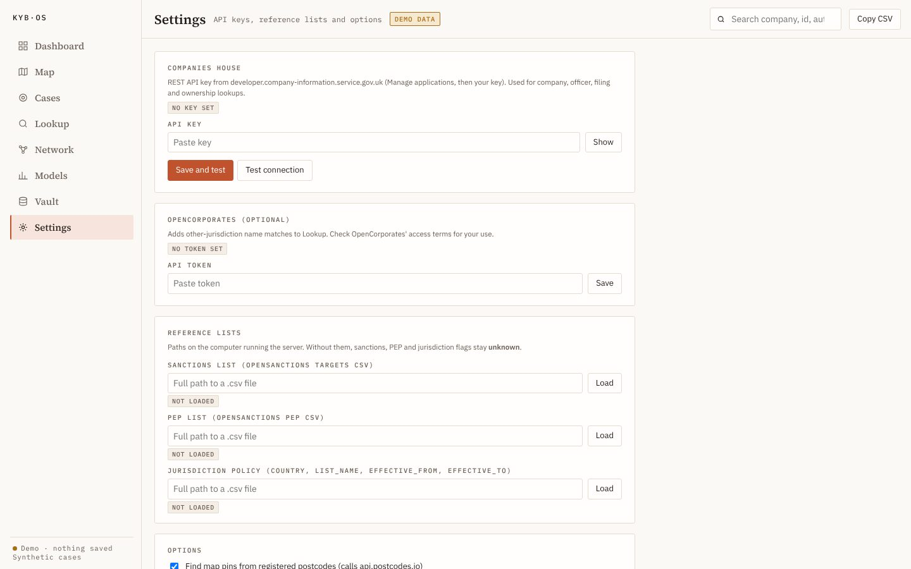

# Inside KYB-OS: One Console for UK Business Due Diligence

*A walk through the platform, tab by tab, from the first screening score to the registry lookup behind it.*

Platform · 19 November 2026 · 6 min read

Know-your-business work usually lives in a drawer of tools: a registry search in one window, a sanctions screen in another, a spreadsheet of who is waiting for review, and a model score nobody can trace. KYB-OS puts those steps in one console. Every view reads the same set of case records, so a flag raised on one tab shows up on the others, and a case moved in the pipeline changes the count on the dashboard.

KYB-OS is a research prototype built for an individual project on UK KYB, KYC and AML screening. Everything on the demo screens runs over synthetic cases. None of it is customer data, and the scores show that the workflow runs, not how well anything performs on real companies.

It is aimed at the compliance teams of UK fintech firms, and a section near the end explains where it fits and what a firm would still need to do before relying on anything like it.

## One console, eight tabs

The tabs follow the order of the work. Dashboard gives the overview. Map and Lookup answer where a company is and what the register says about it. Cases and Network carry the review itself. Models and Vault hold the evidence and the controls behind it, and Settings connects the platform to its data sources.

## Dashboard: What is waiting, and can the team clear it

*Dashboard. Review capacity, flag counts, the screening funnel, the riskiest cases and live signals.*

The console opens on the question a team lead asks first. Of the 300 cases screened, how many need a person, and is that more than the team can review? A capacity bar sets 60 review slots against the queue, which here fills exactly: 5 cases to escalate, 15 for enhanced due diligence and 40 for review. Beside it sit the counts that drive the queue: 15 cases with a sanctions-proximity flag, 19 with a PEP flag, 53 with a jurisdiction flag and 49 with two or more late filings. Eight cases have no late-filing data and stay marked unknown, not zero.

A nine-step funnel runs from intake to cleared, with the share that moves on at each step. The adverse-media step is greyed out and labelled not connected, because that source is not wired in yet. Below the funnel, the riskiest cases are listed by model score, and a signals panel turns the sharpest flags into alerts, such as a sanctions name hit that needs corroboration before anyone escalates it.

## Map: Where the cases sit, and who shares an address

*Map. Local authority shading, risk-coloured pins, shared-address rings and a drawn selection area.*

The map draws Great Britain's 380 local authority areas as vector shapes, shaded by how many cases each holds or by their average score. Pins are coloured by risk band and sized by score. Dashed rings mark registered offices shared by several companies, an old shell-company signal: in the demo, one address holds 25 companies.

Filters narrow the view by score, stage and flag. The area tool lets the user drag a box and get the list of cases inside it, with their average score and a button that copies the IDs. Searching zooms to the matches, and a company checked on the Lookup tab appears as a diamond at its registered postcode.

The locations in the demo are simulated, so the pattern tests the interface and carries no meaning. The boundary set covers Great Britain only; Northern Ireland is not included.

## Cases: From screening to a decision

*Cases. Five stages from Screening to Cleared, with scores and flags on every card.*

Cases move across five columns: Screening, Review, EDD, Decision and Cleared. Each card shows the model score, the company's sector, status and authority, and its flags as chips. Buttons move a case one stage forward or back, open its ownership network, or show it on the map.

Stages come from the logistic regression ranking on the synthetic holdout. The top five cases sit in Decision, the next fifteen in EDD, the next forty in Review, fifty in Screening and the remaining 190 in Cleared. Moves are kept in the browser only, and each one is written to the audit trail on the Vault tab.

## Lookup: One company, checked live

*Lookup. Registry facts, model features and flags for one company. The screen shows a fictional demonstration company.*

The Lookup tab is where the platform meets the real register. Entering a company number, or part of a name, calls Companies House through the local server and returns the features the model uses: age, late filings in the last three years, officer changes in the last twelve months, and flags for jurisdiction, sanctions proximity and PEP status. Officers and persons with significant control are listed below.

One rule runs through the tab. A source that is not loaded leaves its flag as unknown, never clear, and a name-only match against a sanctions or PEP list stays an unresolved candidate until an identifier, a country or a birth year backs it up. A Show on map button places the company at its registered postcode. Live lookups need the local server and a Companies House key.

## Network: Who owns and runs the company

*Network. The company at the centre, with officers, controllers, a corporate owner and flagged entities around it.*

For any case, the Network tab draws the company at the centre with its officers, people with significant control and corporate owner around it. A jurisdiction flag adds a node for a policy-listed country, and a sanctions flag adds a sanctions-list entity two steps out. Clicking a node opens its evidence: where the data comes from, whether a match is corroborated and which rule decided it.

In the demo the links are generated from each case's flags, so they illustrate the view and are not ownership data. With live data the same picture would be drawn from Companies House control records and, where they exist, parent links from the LEI register.

## Models: Which scoring method deserves trust

*Models. Holdout average precision for five methods, and five checks against a published review.*

Five methods are scored on the same 300 held-out cases: a rules scorecard, logistic regression, an explainable boosting machine, a random forest and gradient boosting. On average precision, logistic regression leads at 0.308, against 0.247 for the rules and 0.137 for a random ranking. The tab then says what that does not show. Every confidence interval for the gap to the rules includes zero, because the holdout has only 41 true cases, so no model has been shown to beat the rules.

A second panel tests five recommendations from a published review of machine learning for anti-money laundering. Accuracy is a poor measure here, since a model that flags nothing scores 86.3 percent. The interpretable and post-hoc explanations rank features in close agreement. And the models rank cases usably, but their probabilities are not usable: they predict a 27 percent risk where the observed rate is 13.7 percent.

## Vault: Sources, scopes and the audit trail

*Vault. The source registry, the access-scope switch and the audit trail.*

Vault holds three things. The first is the source registry: 21 UK and global data sources, each marked implemented, planned, manual, deferred or excluded, with what it feeds and what its access terms look like. Six are implemented today.

The second is the access-scope switch. Choosing Partner or Regulator masks company names in every view, a demonstration of how each audience would see its own slice. The third is the audit trail, which records exports, stage changes, scope changes, area queries, live lookups and settings changes. In this prototype the scope switch is a display control, and the server does not enforce it.

## Settings: Keys and reference lists, kept local

*Settings. API keys, reference-list paths and options, with a plain-language connection test.*

Settings connects the platform to the outside world. The user pastes a Companies House API key and presses Save and test, and the page answers in plain language: connected, or the reason it is not, such as a key with stray spaces, a stream key where a REST key is needed, or a blocked IP address. An optional OpenCorporates token sits below it, followed by paths to the sanctions, PEP and jurisdiction-policy files.

Keys go only to the local server. They stay in its memory, never travel back to the page, and show afterwards as the last four characters. A Remember option writes them to a plain-text file on the user's own computer, and Forget everything removes the keys, the paths and that file.

## Where it helps UK fintech firms

Most UK fintechs that handle money, such as payment and e-money firms, lenders and crypto-asset businesses, fall under the Money Laundering Regulations 2017 and are supervised by the FCA. That means identifying who owns and controls each business customer, assessing the risk each one poses, applying enhanced checks to the riskiest, screening against sanctions lists, and keeping records that show why a decision was made. Fintechs tend to do this with small compliance teams, under pressure to onboard quickly, and with several separate vendors to stitch together.

KYB-OS is aimed at that squeeze. Capacity is the central object: the dashboard starts from the number of cases the team can review and ranks the queue to fit it, so scarce hours go to the cases most likely to need them. The unknown-not-clear rule and the corroboration step are designed to address two failures a reviewer fears most, a hit that was silently scored clear and a pile of false alarms from name-only matches. Lookup and Network tie each flag to its source, which is the evidence a firm needs when it explains a decision to its money laundering reporting officer, its auditors or its supervisor.

| Tab | The job it does for a fintech compliance team |
|---|---|
| Dashboard | Sizes the review queue against analyst capacity and shows which flags drive it. |
| Map | Spots clusters across the customer book, such as many businesses at one registered office. |
| Cases | Moves customers through screening, review, enhanced due diligence and decision, with a visible stage. |
| Lookup | Checks a prospective business customer against Companies House at onboarding, with its officers and controllers. |
| Network | Traces ownership and control to the people behind a business and explains a match. |
| Models | Compares a transparent rules baseline with learned models before a score is trusted, and checks calibration. |
| Vault | Records data sources, access scope and an audit trail of who did what. |
| Settings | Connects the firm's own keys and reference lists, which stay on its own computer. |

Several design choices answer concerns specific to regulated firms. A rules scorecard sits beside the learned models, so a firm can start with a rule set it can explain line by line and adopt a model only if it earns its place. Published work on machine learning for anti-money laundering flags interpretability as a concern for regulated firms, and the Models tab reports how closely interpretable and post-hoc explanations agree. Companies House data is free, so a young firm can try the workflow before it commits to an enterprise screening contract. The prototype also reads OpenSanctions exports, and a commercial firm would need to take out the licence that use requires.

### What a firm would still need to do

KYB-OS is a research prototype, not a compliance product. It has not been validated on real customers, nothing in it is legal advice, and it has not been reviewed by the FCA. A firm adopting these ideas would need to test the scoring against its own labelled outcomes, place any model under its model-risk governance, take out the data licences its use requires, handle personal data under UK GDPR, and keep a named person, such as the money laundering reporting officer, accountable for every decision. Several sources that matter to a fintech, such as the Gazette's insolvency notices and the FCA Register, are listed in the registry as planned and are not built yet.

## Why it exists

Because every tab reads the same records, the dashboard, the map and the pipeline cannot drift apart. The research behind the prototype points the same way. A published review of machine learning for anti-money laundering splits the field into client risk profiling and suspicious-behaviour flagging, and a scan of six vendors' public pages found their screening and onboarding tools leaning on configurable rules, with machine learning appearing mostly where the data is images or text. KYB-OS puts a transparent rules baseline and four learned models side by side, so the gain, or the lack of one, is visible.

## What it is, and is not

KYB-OS is a research prototype. Every case on the demo screens is synthetic, the map locations and ownership links are simulated, and the scores show that the workflow runs, not how it would perform on real companies. The Companies House, OpenCorporates and postcode calls have not been run against the live services in this build, and 10 of the 21 listed sources are planned and have no code yet. Northern Ireland is missing from the map.

To run it, install the requests package, start the local server with python ui/serve.py, and open Settings to add a Companies House key.
